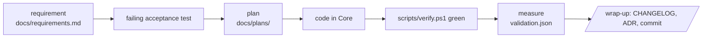

# How this project is developed

For the person or the model that picks this project up later. It is developed almost entirely
with Claude Code; a human reads every diff and decides every requirement, figure and decision.

## The loop

One task per session. A session starts by reading `CLAUDE.md` (automatic) and, for anything
non-trivial, with plan mode. It ends with `/wrap-up`. Long sessions degrade; when the context is
mostly history, wrap up and start a new one.

## Where knowledge lives

| Question | File |
| --- | --- |
| What must it do? | `docs/requirements.md` |
| Why this way? | `docs/decisions/` |
| How well, measured on what? | `docs/validation.md` + `validation.json` |
| What changed, when? | `CHANGELOG.md`, `git log` |
| How is area X built? | the code; `docs/design/x.md` only where the code does not explain itself |
| What was the plan for task Y? | `docs/plans/` |
| What data do tests need? | `tests/testdata/README.md` + `manifest.json` |

Nothing that matters lives in a chat transcript or in the assistant's per-machine memory.

## What the human does

- Accepts or rewrites every requirement before code is written.
- Reads every diff before it is committed; asks for a plain-language summary when it is long.
- Decides whether a validation drift is a regression or a wrong figure.
- Runs `/docs-health` about monthly and after every model change.
- Runs `/code-review` from a second session before merging anything non-trivial.

## What the assistant does not do

- Change tests, fixtures, hashes or figures to make something pass.
- Add packages, skip the gate, force-push, or commit without being asked.
- Describe code structure in docs (it goes stale); it describes behaviour and decisions.

## Rebuilding on a newer model

Not a routine practice: the code plus the tests are the most precise specification there is, and
incremental migration is cheaper than a rewrite. If a rebuild is ever done (platform change,
degraded code), what makes it checkable is, in order: the black-box acceptance tests, the
requirements with IDs, the ADRs, the validation figures with their fixtures. Design notes come
last. `/docs-health` measures how ready the project is for that.
